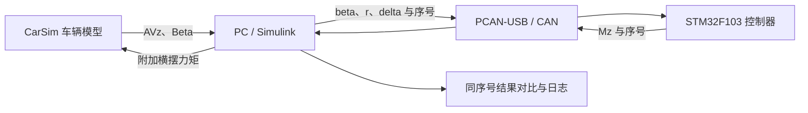
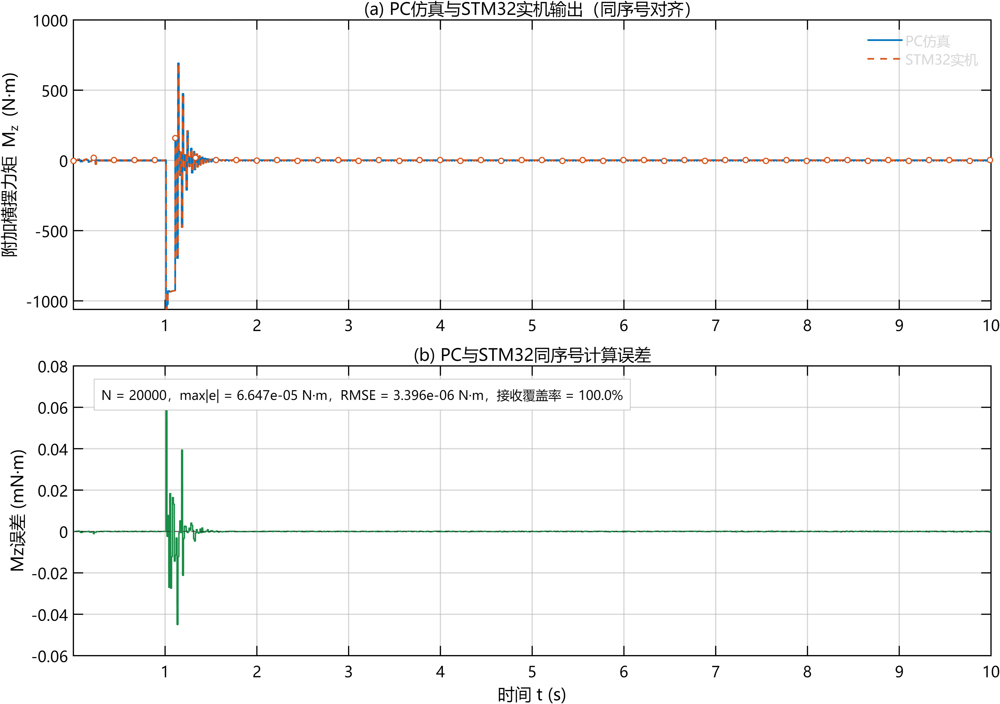
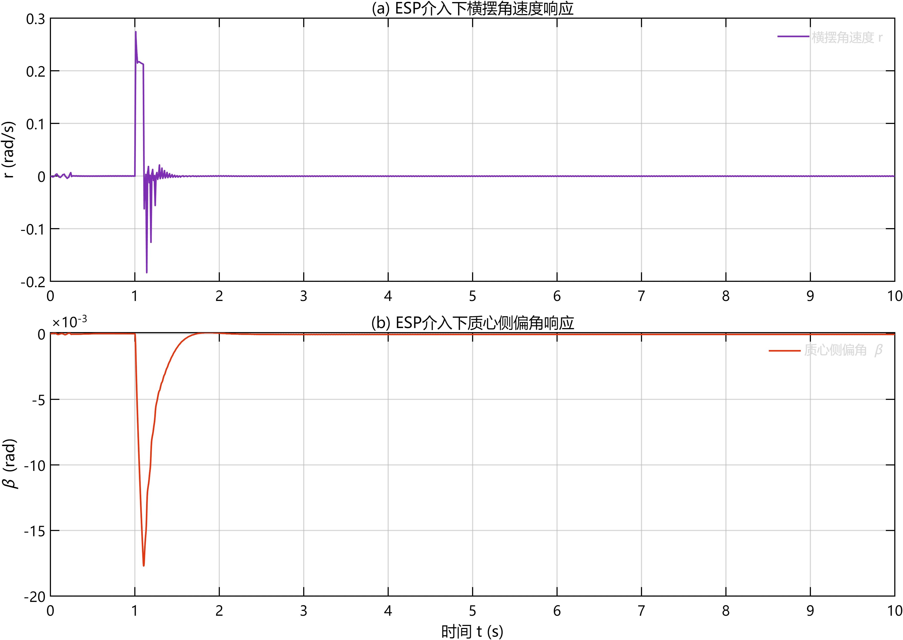

# STM32–CarSim 车辆稳定性控制联合仿真

基于 CarSim、Simulink 与 STM32F103 的车辆横向稳定性控制实验整理：通过 CAN 交换车辆状态与附加横摆力矩，并用样本序号比较 PC 与嵌入式控制器的计算结果。

**当前状态：历史工程整理版。已完成文件与模型配置的静态检查，本次未重新编译、烧录或运行联合仿真。** 环境迁移和版本差异见 [复现说明](docs/reproduction.md)。

## 项目内容

- CarSim 车辆动力学模型与 Simulink 连接，导出横摆角速度和质心侧偏角。
- PC 端按 10 ms 周期发送侧偏角、横摆角速度和转向输入。
- STM32 端通过 CAN 接收中断处理报文，匹配同一序号的输入，计算并返回附加横摆力矩。
- PC 端通过序号缓存匹配本地和远端输出，记录计算误差与匹配有效标记。
- 保留历史 CAN FIFO 释放修复脚本、控制器实现和实验结果图，方便审查实现过程。

图中展示模型设计的数据流。具体控制通路和开关状态应在复现实验中核对；结构图不是整套闭环已在本次验证的证明。

## 环境与实验配置

| 项目 | 已读取的配置 |
|---|---|
| CarSim | 2024.1 |
| MATLAB / Simulink | 模型保存版本 R2025a |
| MCU | LED.ioc 指定 STM32F103C8T6，72 MHz |
| CAN 接口 | PCAN-USB；STM32 CAN_RX=PB8、CAN_TX=PB9 |
| CAN 速率 | PC 模型与 LED.ioc 均为 500 kbit/s；STM32 SLX 另存有 1 Mbit/s 字段，需核对生成结果 |
| 车辆 / 工况 | C-Class Hatchback；直线；目标速度 30 m/s；附着系数 0.85 |
| PC 模型步长 | 活动配置为 0.0005 s |
| PC 状态发送周期 | 0.01 s（100 Hz） |
| 历史运行时长 | 10 s |

物理开发板、CAN 收发器型号和接线照片仍待补充。软件保存配置不等同于已核验的实物配置。

## 历史结果

上图原始标注：最大绝对误差 `6.647e-05 N·m`，RMSE `3.396e-06 N·m`，有效标记覆盖率 `100.0%`。这些数字来自已有图片，本次没有原始时序数据可用于重算，也未确认它与随包模型、运行日志属于完全相同的一次实验。

图中的 `N=20000` 是绘图记录的点数，不能据此宣称 CAN 每秒收发 2000 个独立控制样本。绘图脚本中的覆盖率来自 `valid_log`，也不能直接等同于 CAN 零丢包率。

本项目目前没有附上同工况关闭控制器的对照数据，因此不报告稳定性提升百分比。控制器以附加横摆力矩为输出，不宣称已完成四轮制动力分配或实车 ESP 验证。

## 目录

| 路径 | 内容 |
|---|---|
| `models/pc/` | PC 与 CarSim 联合仿真模型 |
| `models/stm32/` | STM32 控制器模型 |
| `hardware/LED.ioc` | 原始 CubeMX 硬件配置 |
| `parameters/` | MATLAB 车辆参数与状态空间矩阵脚本 |
| `algorithms/` | 从 SLX 提取的可读 MATLAB Function 代码 |
| `scripts/` | 原始构建修复与绘图脚本 |
| `can/legacy/` | 旧 DBC，不能作为当前模型的完整协议使用 |
| `results/historical/` | 历史图与运行日志 |
| `docs/` | 复现、通信协议、验证边界和来源记录 |

建议先阅读 [复现说明](docs/reproduction.md)、[CAN 协议](docs/can-protocol.md) 和 [验证记录](docs/validation.md)。

## 发布与贡献

本整理版尚未选择开源许可证；代码、模型及图表的原始来源和可授权范围需要由维护者确认后写入正式 LICENSE 与致谢。CarSim 标准车辆数据库、软件安装文件和生成缓存不随包发布，使用者需要自己的软件环境与数据库。

欢迎围绕复现问题、协议说明、日志导出及对照实验提出改进。报告问题时请提供软件版本、模型版本、硬件配置和最小复现步骤。
